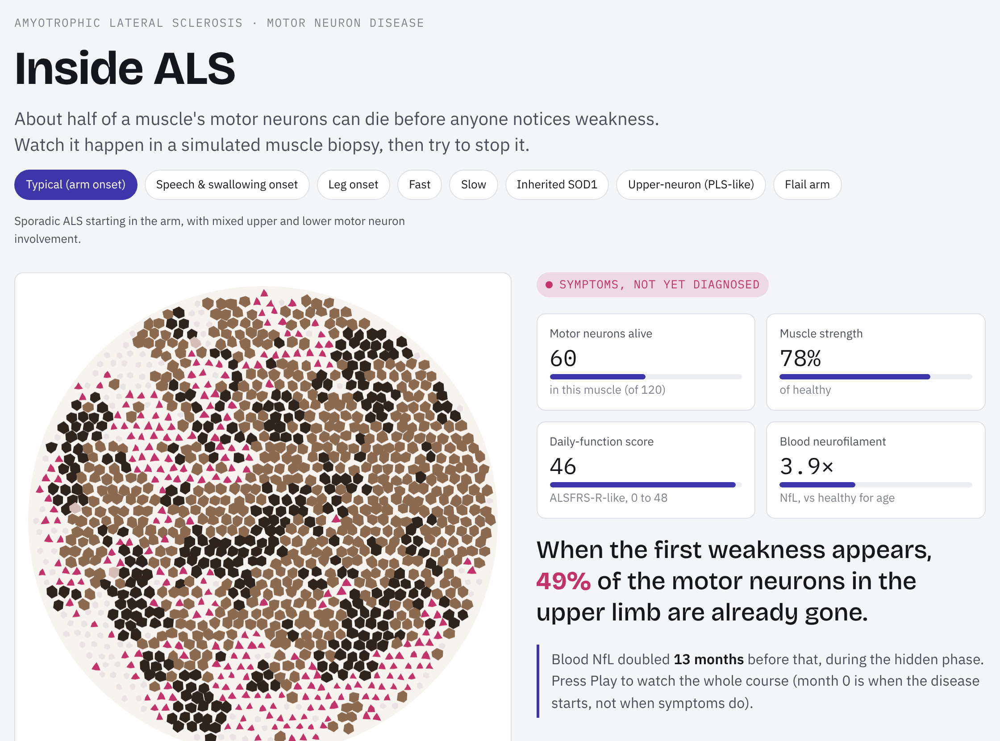
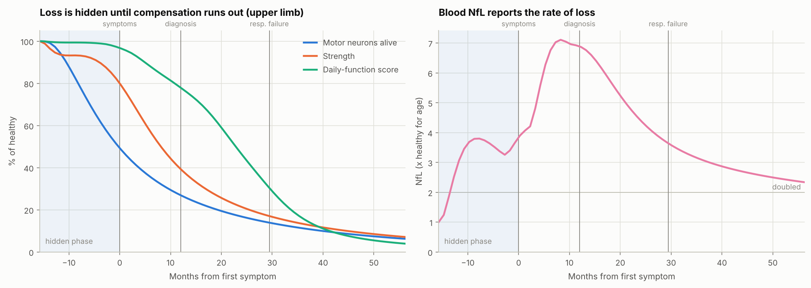
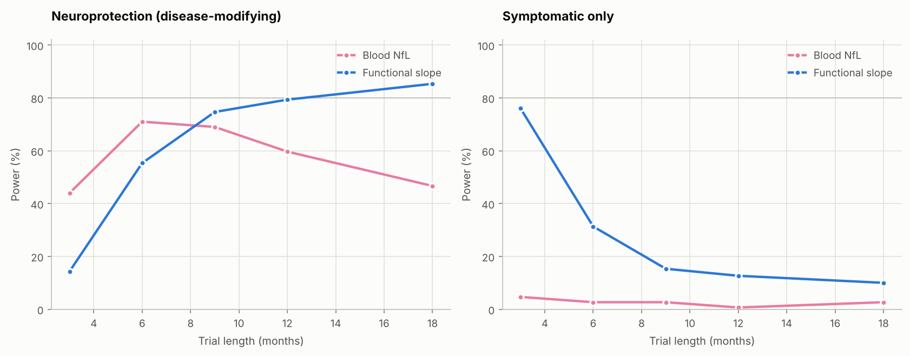
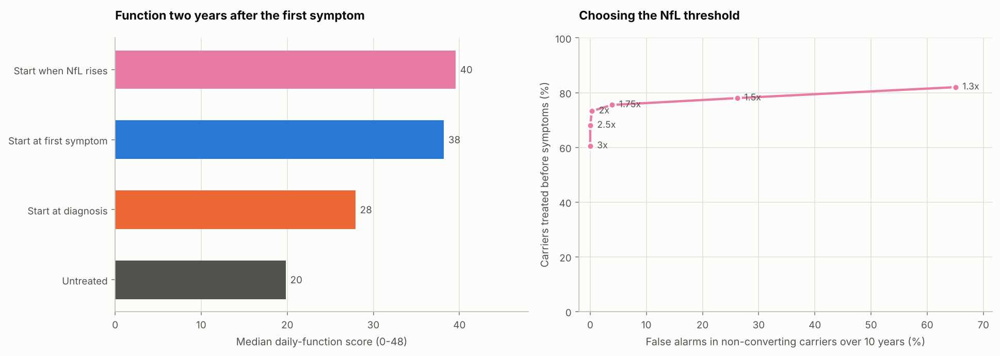
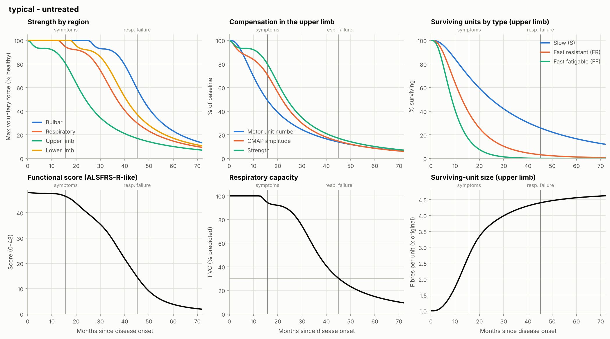
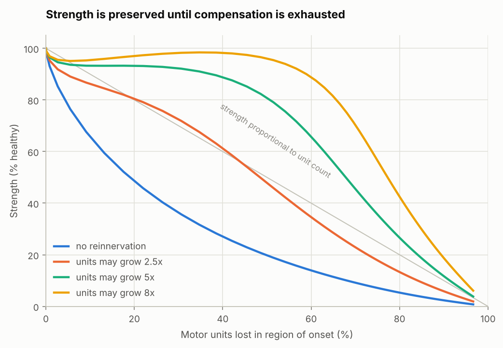
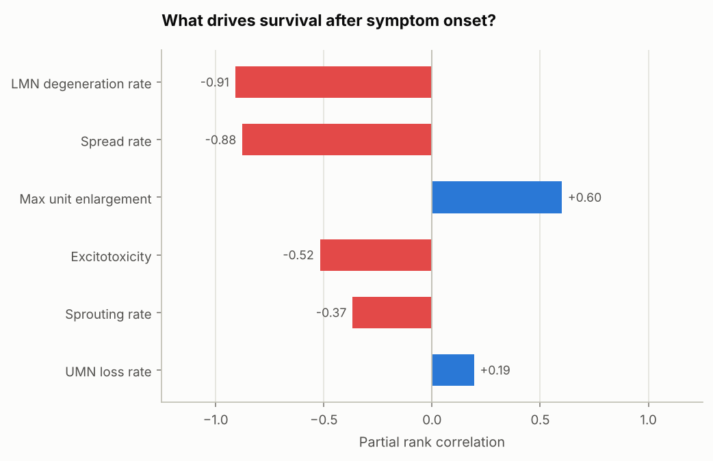

# mndsim — motor unit degeneration simulator

[](https://github.com/ProudStone-576/motor-unit-degeneration-simulator/actions/workflows/ci.yml)

[](LICENSE)

**An open, mechanistic simulator of ALS / motor neuron disease, from single motor units to virtual clinical trials, in Python and in your browser.**

`mndsim` follows every motor unit in a muscle as motor neurons die:

- the collateral reinnervation that hides the loss;
- the upper motor neurons that drive and stress them;
- the spread of disease across the body;
- the neurofilament released into blood by dying axons.

It turns all of this into the measures clinicians and trialists use: a 48-point functional score, FVC, motor unit number estimates (MUNE), CMAP, blood neurofilament light (NfL) and survival.

> [!IMPORTANT]
> `mndsim` is a **research and teaching tool**. Parameters are illustrative and calibrated only to population-level summaries from the literature (see [Calibration](#calibration)). It does not predict the course of any real person and is not medical advice.

## Try it in your browser: *Inside ALS*

[](https://proudstone-576.github.io/motor-unit-degeneration-simulator/)

**[proudstone-576.github.io/motor-unit-degeneration-simulator](https://proudstone-576.github.io/motor-unit-degeneration-simulator/)** needs no installation and works on a phone. The whole engine runs locally in the browser, from a JavaScript port that a CI test holds to the Python engine's numbers. The app has four parts:

- **A live muscle biopsy.** About 1,300 fibres coloured like an ATPase stain. Watch neurons die, fibres shrink, and survivors adopt orphans until *fibre-type grouping* appears, the classic sign of chronic denervation. The amount of denervation matches the engine month by month.
- **The hidden phase.** Neuron loss, strength, function and blood NfL on one timeline, with sliders for speed, spread and compensation.
- **Treatment timing.** The same patient under six mechanisms, started anywhere from before symptoms to years after.
- **A virtual trial designer.** Choose a mechanism, size, length and enrichment. Hundreds of virtual patients are screened, and replicate trials estimate power for five endpoints.

(Maintainers: enable *Settings → Pages → Source: GitHub Actions* once, and the app redeploys on every push to `main`. It also deploys to Vercel as-is: import the repository at [vercel.com/new](https://vercel.com/new) and `vercel.json` handles the build. To run it locally: `node web/build_site.mjs`, then serve `_site/` with any static server.)

## The hidden phase: what the model predicts

Motor neurons die for many months before symptoms because survivors reinnervate orphaned fibres. NfL reports the **rate** of axonal loss; function reports the **state** left after compensation. Building both into one mechanism yields testable predictions. These are model results under illustrative parameters, reproducible with `python examples/make_figures.py`.



**1. Loss is hidden, but not invisible.** When weakness first appears, about half of the region's motor neurons are already gone (median 48% in the virtual population). Blood NfL doubles a **median of 11 months before the first symptom** (IQR 5–17). This was not tuned: it emerges from the mechanism and agrees with prospective studies of gene carriers (Benatar et al. 2018).

**2. Each mechanism leaves a fingerprint across endpoints and time.** The figure below shows simulated power with 60 patients per arm. A disease-modifying drug (left) is detected first by NfL: 44% power at 3 months and 71% at 6 months, versus 14% and 55% for the functional slope. Function overtakes NfL only in longer trials. A purely symptomatic drug (right) is the mirror image: function catches it immediately (76% at 3 months, fading as the slope dilutes a one-time jump), while NfL never moves. This is the pattern seen when an antisense therapy cut NfL but missed its 28-week functional endpoint (Miller et al. 2022). A mechanism that only nudges the rate of axon loss (the anti-excitotoxic archetype) is the reverse case: function beats NfL. The model tells you which situation you are in *before* you run the trial.



**3. Timing beats almost everything else.** The figure below covers 400 virtual SOD1 carriers on a gene-targeted therapy. Waiting for a formal diagnosis roughly halves the benefit compared with starting at the first symptom: median function two years after symptom onset is 28 versus 38 out of 48, against 20 untreated. Monitoring NfL every 3 months and starting when it doubles from the person's own baseline treats about 73% of carriers before any symptom (median function 40). Over 10 years, that rule falsely alarms in 0.3% of carriers who never convert. Lowering the threshold to 1.5× catches only a few more people early but raises false alarms to 26%, partly because healthy NfL drifts up with age.



Run these analyses yourself:

```python
from mndsim import hidden_phase as hp, TREATMENTS, TrialDesign, build_trial_pool, power_by_duration
from mndsim.phenotypes import TYPICAL

hp.response_lag(TYPICAL, TREATMENTS["neuroprotective"])  # NfL vs function response, by start stage
pool = build_trial_pool(TREATMENTS["neuroprotective"], TrialDesign(n_per_arm=60, duration=18))
power_by_duration(pool, [3, 6, 12, 18])  # endpoint fingerprints
hp.trigger_strategies(TREATMENTS["gene_targeted"]).summary()  # NfL-triggered prevention
hp.threshold_tradeoff()  # lead time vs false alarms
```

---

## Install

```bash
pip install "git+https://github.com/ProudStone-576/motor-unit-degeneration-simulator"
# or, to develop:
git clone https://github.com/ProudStone-576/motor-unit-degeneration-simulator
cd motor-unit-degeneration-simulator
pip install -e ".[dev,app]"
```

It needs Python 3.10+ and depends only on NumPy, SciPy, pandas and Matplotlib.

## Quick start

```python
import mndsim
from mndsim.phenotypes import TYPICAL

result = mndsim.simulate(TYPICAL, months=72)  # one virtual patient, 6 years
result.summary()  # symptom onset, survival, slopes, MU loss...
result.plot()  # six-panel overview, shown below
df = result.to_frame()  # tidy table: one row per month

# Same patient, neuroprotection started at diagnosis
onset = result.symptom_onset[0]
treated = mndsim.simulate(TYPICAL, mndsim.TREATMENTS["neuroprotective"].at(onset + 12), months=72)
print(treated.event_time - result.event_time)  # months gained to respiratory failure
```



Or from the command line:

```bash
mndsim list                                          # phenotypes and treatment archetypes
mndsim lag --phenotype typical --treatment neuroprotective   # biomarker vs function response
mndsim prevention --threshold 2 --plot prevention.png        # NfL-triggered treatment in carriers
mndsim simulate --phenotype bulbar_onset --treatment neuroprotective --plot course.png
mndsim compare neuroprotective nmj_stabilizer symptomatic --start-after-onset 6 --plot cf.png
mndsim cohort --n 1000 --csv cohort.csv --plot cohort.png
mndsim trial --treatment anti_excitotoxic --sample-sizes 50 100 200 300 --plot power.png
mndsim fit visits.csv --fvc-col fvc --onset-region bulbar --forecast neuroprotective
mndsim sensitivity --plot tornado.png
```

Besides the browser app, there is a Streamlit explorer for local use:

```bash
streamlit run app/streamlit_app.py
```

## What the model captures

Each of four regions (bulbar, respiratory, upper limb, lower limb) has its own pool of 120 motor units.

| Mechanism | How it is modelled | Grounding |
|---|---|---|
| **Size principle and force** | Exponentially distributed twitch forces and recruitment thresholds; rate coding with a sigmoidal force–frequency relation | Henneman 1957; Fuglevand, Winter & Patla 1993 |
| **Selective vulnerability** | Hazard by unit type: fast-fatigable > fast-resistant > slow, plus unit-to-unit variability | Frey et al. 2000; Pun et al. 2006 |
| **Dying-back** | Units pass through a *denervating* state: unreliable transmission and retracting terminals, before the motoneuron is lost | Fischer et al. 2004 |
| **Collateral reinnervation** | Surviving healthy units adopt orphaned fibres, up to a maximum enlargement; FF units sprout poorly | Frey et al. 2000 |
| **Irreversible denervation** | Fibres orphaned for too long degenerate and can no longer be rescued | — |
| **Upper motor neuron loss** | Lowers maximal voluntary drive to each pool | — |
| **Excitotoxicity ("dying forward")** | Glutamatergic drive from surviving UMNs amplifies LMN hazard | Eisen et al. 1992; Vucic et al. 2008 |
| **Focal onset and contiguous spread** | Disease reaches regions with a delay proportional to neuraxis distance | Ravits & La Spada 2009 |
| **Blood neurofilament light** | Released by degenerating LMN and UMN axons in proportion to axon size and length; healthy level rises with age; first-order clearance | Khalil et al. 2018 |
| **Clinical read-outs** | 12-item, 48-point functional score modelled on the ALSFRS-R structure; FVC; MUNE; CMAP; MUP size; respiratory-failure event | Cedarbaum et al. 1999 |

Simulations are **mean-field** (expected trajectories, deterministic) or **stochastic** (individual unit fates, giving the step-wise MUNE decrements seen in serial studies). Both run vectorised over patients × regions × units; a 3,000-patient, 20-year cohort takes about half a minute on a laptop.

The full equations, every parameter, and where each value comes from are in **[docs/MODEL.md](docs/MODEL.md)**.

## Gallery

<table>
<tr>
<td width="50%"><br>
<b>Every motor unit's fate.</b> Large fast-fatigable units are lost first and slow units last. Orange marks the dying-back phase.</td>
<td width="50%"><br>
<b>The clinical threshold.</b> Reinnervation keeps strength near normal until about half the units are gone. Without it, losing the largest units first makes weakness <i>disproportionate</i>.</td>
</tr>
<tr>
<td><br>
<b>Timing matters.</b> The same drug started at symptom onset, at diagnosis, or a year later.</td>
<td><br>
<b>Virtual cohort.</b> Heterogeneous patients; bulbar onset progresses fastest and lower-limb onset slowest.</td>
</tr>
<tr>
<td><br>
<b>In-silico trial design.</b> Power by endpoint for a modest anti-excitotoxic effect. Survival is badly underpowered in 12 months.</td>
<td><br>
<b>Global sensitivity (LHS + PRCC).</b> Which parameters drive survival after symptom onset.</td>
</tr>
</table>

Regenerate every figure with `python examples/make_figures.py`.

## Tour

### Patients and phenotypes

```python
from mndsim import Patient, PHENOTYPES

list(PHENOTYPES)
# ['typical', 'lower_limb_onset', 'bulbar_onset', 'fast_progressor', 'slow_progressor',
#  'umn_dominant', 'lmn_dominant', 'flail_arm', 'sod1_familial', 'healthy']

me = Patient(
    onset_region="bulbar",
    lmn_rate=0.12,
    spread_rate=0.06,
    region_severity={"lower_limb": 0.5},
    genotype="C9orf72",
)
```

`umn_dominant` (PLS-like) weakens through lost drive with almost no LMN loss. `lmn_dominant` (PMA-like) does the opposite, and `flail_arm` stays confined to the arms for years. Time zero is biological disease onset; **symptom onset is emergent**. It happens when compensation can no longer hide the loss.

### Treatments are mechanisms, not drug names

```python
from mndsim import Treatment, TREATMENTS
# placebo, neuroprotective, anti_excitotoxic, nmj_stabilizer,
# sprouting_enhancer, symptomatic, gene_targeted (SOD1 only)

my_drug = Treatment(
    name="my_compound",
    lmn_protection=0.3,  # -30% LMN hazard
    nmj_rescue=0.05,  # re-stabilise denervating units
    ramp=3.0,  # months to reach full effect
    target_genotype=None,  # or e.g. "SOD1"
)
combo = TREATMENTS["neuroprotective"] + my_drug  # protections compose multiplicatively
mndsim.simulate(me, combo.at(start=24, stop=48))  # with washout after stopping
```

All library effect sizes are **illustrative archetypes**, not estimates for real drugs.

### Cohorts, trials and power

```python
cohort = mndsim.sample_cohort(1000, seed=1)  # heterogeneous virtual population
res = mndsim.simulate(cohort, months=150)
res.summary().groupby("onset_region").survival_from_symptom_onset.median()

design = mndsim.TrialDesign(n_per_arm=150, duration=12, min_fvc=70, min_delta_fs=0.0)
pool = mndsim.build_trial_pool(TREATMENTS["anti_excitotoxic"], design, seed=1)
mndsim.run_trials(pool, n_trials=500).power()  # power per endpoint
mndsim.power_curve(pool, [50, 100, 200, 300])  # sample-size planning
pool.individual_effects()  # per-patient effect: both potential outcomes
```

Each eligible virtual patient is simulated **twice**, untreated and treated from enrolment. Replicate trials then resample the pool, randomise, and add dropout and rater noise. They analyse five endpoints:

- functional slope (Welch's t-test on per-patient slopes)
- survival (log-rank, with a Peto hazard ratio)
- CAFS (Berry et al. 2013)
- MUNE decline in the region of onset
- FVC slope

A placebo pool gives about the nominal false-positive rate. The test suite checks this.

### Digital twins

```python
fit = mndsim.fit_patient(
    months_since_onset=[2, 5, 8, 11, 14],
    alsfrs=[47, 43, 41, 37, 34],
    fvc=[92, 97, 84, 71, 53],
    onset_region="bulbar",
)
fit.confidence_intervals()  # estimates with approximate 95% CIs
fit.counterfactual(TREATMENTS["neuroprotective"], start_after_onset=6)
```

On synthetic data the fit recovers the generating parameters within their confidence intervals (see `tests/` and `examples/04_digital_twin.py`).

### Sensitivity analysis

```python
sa = mndsim.global_sensitivity(n_samples=400)  # Latin hypercube + PRCC
sa.ranking("mu_loss_at_symptom_onset")  # max enlargement dominates (PRCC ~ 0.99)
mndsim.sweep("max_enlargement", [1, 2.5, 5, 8])  # one-at-a-time
```

## Calibration

The defaults were tuned so the virtual population reproduces commonly reported, population-level features of sporadic ALS. They were **not** fitted to individual patient data. Reproduce this table with `python examples/calibration_report.py`.

| Quantity | Model (n = 3,000) | Commonly reported |
|---|---|---|
| Median survival from symptom onset | 32 months | about 2–4 years |
| Alive 5 years after onset | 16% | about 10–20% |
| Median survival by onset: bulbar / upper limb / lower limb | 25 / 29 / 47 months | bulbar onset carries the worst prognosis |
| Functional score slope, first year (median; 10th–90th percentile) | −0.68 (−1.59 to −0.32) points/month | median roughly −0.6 to −1.0, wide and right-skewed |
| Progression rate at diagnosis, ΔFS (median) | 0.83 points/month | strongly prognostic (Kimura et al. 2006) |
| Functional score at diagnosis (median) | 39 / 48 | high 30s in trial populations |
| Motor units lost when weakness appears (median) | 48% | substantial loss precedes weakness |
| NfL at diagnosis (median, × healthy for age) | 4.5× | several-fold above controls |
| NfL doubling before first symptom (median) | 11 months (not tuned) | rises in the months to about a year before onset in carriers (Benatar et al. 2018) |
| Correlation of NfL with progression rate ΔFS | r ≈ 0.5 | moderate, prognostic |

Treat any single number as one model's output under stated assumptions, not as a fact about ALS.

## Limitations

Read these before drawing conclusions:

- **One pool per region.** Real regions contain many muscles, and laterality (left/right spread) is not modelled.
- **Respiratory failure is the only terminal event.** It stands for "death or permanent ventilation"; bulbar complications, nutrition and NIV are not modelled.
- **Survival is too predictable.** Survival correlates with ΔFS at r ≈ −0.92, far stronger than in real cohorts, because there is no unmodelled clinical variability (care, comorbidity, intercurrent illness).
- **FVC is a proxy.** It equals respiratory pool strength. The lower tail of FVC at diagnosis is probably too heavy; FVC < 70% is the main reason for the roughly 35% trial screen-failure rate.
- **The functional score mimics the structure of the ALSFRS-R, not the instrument.** Item thresholds are illustrative.
- **NfL is on an illustrative scale.** Release weights and clearance half-life are assumptions. Bulbar-onset NfL comes out slightly *lower* than limb onset (short axons), whereas real cohorts often show the opposite. Read NfL as a multiple of healthy, not in absolute pg/mL.
- **Treatment effects are mechanism archetypes.** They have no pharmacokinetics beyond first-order ramp and washout.
- **Calibration matches population summaries only.** Individual-level validity (for example, of fitted twins) is untested on real data.
- **No cognition or behaviour.** The frontotemporal spectrum is outside scope.

Issues and pull requests that address these are very welcome.

## Project layout

```
src/mndsim/
  pool.py         motor-unit pool (size principle, force)        engine.py      vectorised simulator (incl. NfL)
  hidden_phase.py biomarker lag, NfL-triggered prevention         
  patient.py      Patient parameters                             result.py      SimulationResult
  phenotypes.py   preset patients                                treatment.py   mechanism-based treatments
  cohort.py       population model                               trial.py       in-silico RCTs, power
  fitting.py      digital-twin fitting                           sensitivity.py LHS + PRCC, sweeps
  scoring.py      functional score, FVC                          plotting.py    figures
  config.py       physiological constants                        cli.py         `mndsim` command
web/              "Inside ALS" browser app + JavaScript engine (mndsim.js) and its parity test
app/              Streamlit explorer
examples/         runnable scripts (quick start, counterfactuals, trial design, digital twin, figures)
docs/MODEL.md     model equations, parameters and references
tests/            pytest suite (invariants, mechanisms, statistics, CLI)
```

## Contributing

Contributions from modellers, clinicians, electrophysiologists and software engineers are all valuable. Better parameter estimates with references are especially welcome. See [CONTRIBUTING.md](CONTRIBUTING.md). In short:

```bash
pip install -e ".[dev]"
pytest && ruff check . && ruff format --check .
```

## Citing

If `mndsim` helps your work, please cite it using [CITATION.cff](CITATION.cff) (GitHub shows a "Cite this repository" button).

## Origins

The project began as a five-node signal-flow prototype (cortex → UMN → LMN → NMJ → muscle) with linear degeneration and a neural-ODE experiment. Version 0.1 rebuilt it around an explicit motor-unit pool, so that compensation, selective vulnerability and electrophysiological read-outs emerge from the mechanism rather than being assumed. The prototype remains in the git history.

## License

[MIT](LICENSE)
